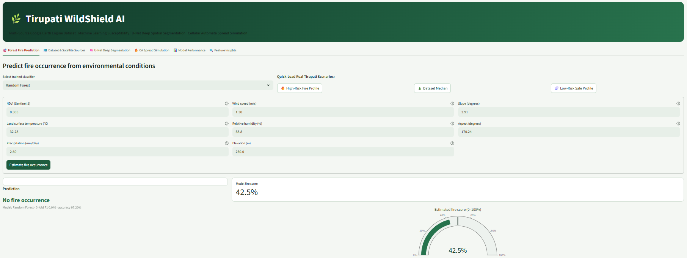
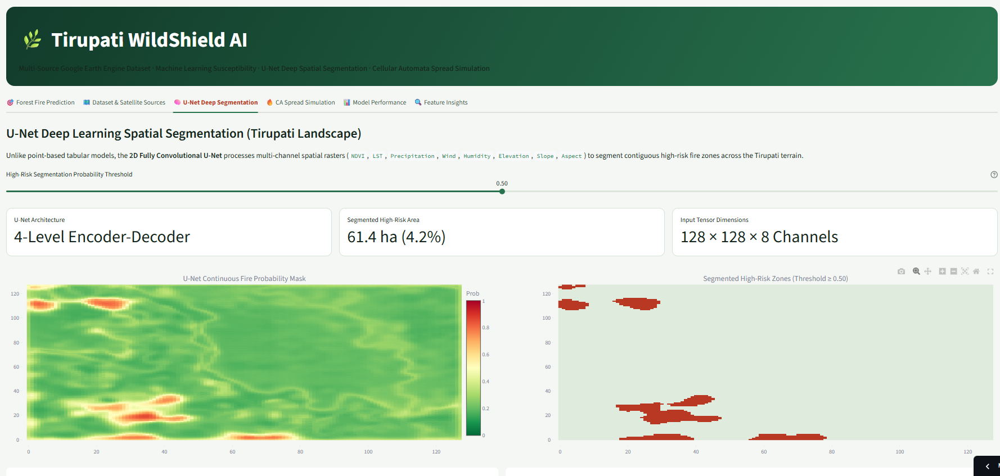
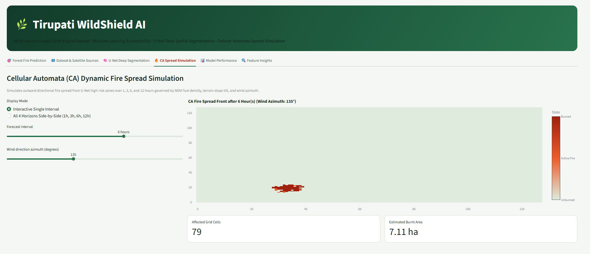

# 🌿 WildShield AI
### Multi-Source Satellite Wildfire Susceptibility, U-Net Deep Spatial Segmentation & Cellular Automata Spread Simulation


## 📌 Overview
**WildShield AI** is an end-to-end geospatial AI and simulation platform designed to predict wildfire susceptibility, segment high-risk spatial burn zones, and simulate real-time fire propagation across the **Tirupati forest ecosystem**. Integrating **Google Earth Engine** satellite remote sensing data with tabular ensemble ML, **U-Net** deep spatial segmentation, and **Cellular Automata (CA)** modeling, the platform delivers a 6-module interactive decision-support suite.

---

## 🖥️ Platform Modules & Visual Previews

1. **Forest Fire Prediction:** Interactive risk inference across geographic coordinates and environmental inputs.
2. **Dataset & Satellite Sources:** Multi-source geospatial pipeline extracted via **Google Earth Engine** (vegetation indices, topography, land surface temperature, meteorological layers).
3. **U-Net Deep Segmentation:** Encoder-decoder convolutional architecture predicting pixel-level spatial burn/risk masks on geospatial patches.
4. **CA Spread Simulation:** Dynamic **Cellular Automata** propagation engine simulating step-by-step fire spread across terrain grids.
5. **Model Performance:** Comparative benchmarking across classical ML and Deep Learning architectures (Accuracy, Precision, Recall, F1-Score, ROC-AUC).
6. **Feature Insights:** Environmental driver analysis and feature importance diagnostics.

### 🎯 Interactive Forest Fire Prediction


### 🧠 U-Net Deep Spatial Segmentation (128 × 128 × 8 Channels)


### 🔥 Cellular Automata (CA) Dynamic Fire Spread Simulation

---

## 📊 Model Benchmarking & Performance

| Model Architecture | Paradigm | Accuracy | F1-Score | Role in System |
| :--- | :--- | :---: | :---: | :--- |
| **Random Forest** | Bagging Ensemble | **97.2%** | **0.94** | Top tabular susceptibility classifier |
| **XGBoost** | Gradient Boosting | **96.5%** | **0.93** | High-speed tabular risk scoring |
| **Decision Tree** | Classical ML | **95.8%** | **0.92** | Interpretable rule-based benchmark |
| **U-Net (Spatial Patch CNN)** | Deep Learning | **93.11%** | **0.90** | Pixel-level spatial burn/risk segmentation |
| **Logistic Regression** | Linear Baseline | **91.7%** | **0.89** | Linear baseline benchmark |

---

## 🛠️ Tech Stack
- **Deep Learning & Computer Vision:** PyTorch, U-Net Spatial Segmentation
- **Machine Learning:** XGBoost, Random Forest, Decision Tree, Logistic Regression, Scikit-Learn
- **Geospatial & Simulation:** Google Earth Engine (GEE), Cellular Automata (CA), NumPy, Pandas
- **Application & Visualization:** Streamlit, Matplotlib, Seaborn, Plotly

---

## 🚀 Run Locally
```bash
git clone [https://github.com/ggunjan229/](https://github.com/ggunjan229/)<your-wildshield-repo>.git
cd <your-wildshield-repo>
pip install -r requirements.txt
streamlit run app.py
